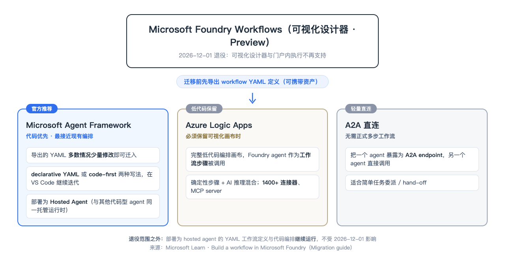

Microsoft Foundry Workflows 将于 **2026 年 12 月 1 日退役**。如果你已经用可视化设计器搭建了工作流，现在需要保存定义，并选择后续运行方式。

微软给出了三条路径：用 **Microsoft Agent Framework** 继续编排、用 **Azure Logic Apps** 保留可视化业务流程，或通过 **A2A** 让一个 Agent 直接调用另一个。视频演示第一条路径，下面也会说明另外两条适合解决什么问题。[官方迁移指南](https://learn.microsoft.com/en-us/azure/foundry/agents/concepts/workflow#migration-guide)

退役之后，Foundry 门户里的工作流设计器和门户内执行不再受支持。官方说明，基于 YAML 的工作流定义部署为 Hosted Agent 后仍可运行；现有 Hosted Agent 中的代码编排也不受这次退役影响。具体流程能否按原样运行，仍要检查依赖并做回归测试。

## 迁移前：先保存 YAML

在 Foundry workflow 设计器中切换到 **YAML** 视图，复制或导出定义，并保存一份原始副本。它记录了原流程的步骤、Agent 调用、变量和分支，是迁移时的对照材料。

同时记下模型、Agent、工具连接、认证方式，以及几条能覆盖正常流程、分支和审批的测试请求。YAML 对三条路径都有参考价值，但不能假定 Logic Apps 或 A2A 可以直接导入这份文件并自动还原流程。

*图：三种迁移方向。YAML 可作为原流程的参考；采用 Logic Apps 或 A2A 时，需要根据目标方案重新设计并验证。*

## 路径一：用 Agent Framework 继续运行 YAML

如果希望延续现有的多 Agent 编排，又能接受用 YAML 和代码维护，Microsoft 建议多数团队从 **Agent Framework** 开始。官方说明，很多情况下，导出的 YAML 只需少量修改，就可以放进 Agent Framework 项目运行；也可以选择用代码重新实现编排。[官方迁移说明](https://learn.microsoft.com/en-us/azure/foundry/agents/concepts/workflow#option-1-microsoft-agent-framework-recommended)

视频中的新闻工作流由四个 Agent 顺序处理选题、获取、筛选和报告。演示把工作流 YAML 加入本地 Agent Framework 项目，使用 `WorkflowFactory` 加载并运行，最后展示新闻结果。

<iframe
  src="//player.bilibili.com/player.html?bvid=BV17SWH6QEi4&cid=43442114390&p=1"
  width="100%"
  height="500"
  frameborder="0"
  allowfullscreen
  title="如何对Foundry Agent Workflows做迁移"
>
</iframe>

*视频：从 Foundry 导出工作流定义，在本地 Agent Framework 项目中加载并运行。*

这个演示说明的是本地运行。若需要在 Foundry 上托管，仍需准备并部署 Hosted Agent，然后测试部署后的行为。另一种方式是使用 Foundry Toolkit 的 **Generate Code**，借助 GitHub Copilot 将定义转换成 Python 或 C#；生成结果需要人工检查，不能假定与原流程等价。[Toolkit 迁移指南](https://learn.microsoft.com/en-us/azure/foundry/how-to/develop/vs-code-agents-workflow-low-code)

无论加载 YAML 还是转换代码，都要对照原定义核实 Agent 连接、分支、变量和人工审批。尤其是 Power Fx 表达式和外部连接，应逐项检查目标实现如何处理。

## 路径二：用 Logic Apps 保留可视化业务流程

如果团队需要继续用画布维护流程，或者工作流主要负责连接业务系统，可以考虑 **Azure Logic Apps**。它能用事件或计划触发流程，并组合条件判断、连接器和 Foundry Agent 调用。

例如，报销申请到达后，Logic Apps 读取表单、检查必填字段，调用费用审核 Agent；再根据结果进入审批或补件步骤，最后更新业务系统。流程负责固定步骤和系统连接，Agent 负责理解材料或提供判断。

迁移时，可以先把原流程拆成“触发、判断、Agent 调用、等待和写入”，再逐项重建。要特别检查变量与表达式如何映射、审批如何恢复，以及重试时是否会重复写入数据。原 YAML 是设计对照，不是自动转换保证。

微软的 [Logic Apps 集成指南](https://learn.microsoft.com/en-us/azure/logic-apps/automate-foundry-agents-with-workflows)适用于 **Logic Apps Standard**；其中将 Foundry Agent 接入工作流的能力目前为 Preview，可能产生费用。选择前应核对区域、连接、认证和网络要求，并用实际流程验证。

## 路径三：用 A2A 直接委派任务

如果原流程只是让一个 Agent 把任务交给另一个 Agent，可以考虑 **Agent-to-Agent（A2A）**。例如，客服 Agent 把退款政策问题委派给退款政策 Agent，再根据返回结果继续回复用户。

被调用方需要提供兼容 A2A 的 endpoint；调用方配置连接和认证后，才能发起请求。若目标也是 Foundry Agent，需要按官方要求启用传入 A2A。调用双方的权限、传递的上下文、超时及失败处理仍需单独设计。[启用 A2A endpoint](https://learn.microsoft.com/en-us/azure/foundry/agents/how-to/enable-agent-to-agent-endpoint)；[从 Foundry Agent 调用 A2A](https://learn.microsoft.com/en-us/azure/foundry/agents/how-to/tools/agent-to-agent)

A2A 适合轻量委派，但不会自动替代固定的多步业务流程。如果任务必须依次查订单、判断金额、等待主管批准并写回系统，就需要明确管理顺序、审批和失败恢复；可以考虑用 Logic Apps 或 Agent Framework 承载流程，再按需要加入 A2A 调用。

## 三条路径怎么选？

| 你的主要需求 | 优先考虑 | 迁移时重点检查 |
|---|---|---|
| 延续现有编排，团队可以维护 YAML 或代码 | **Microsoft Agent Framework** | YAML 兼容性、Agent 连接、分支与审批；部署后的运行结果 |
| 保留可视化画布，流程需要事件触发、跨系统连接或人工审批 | **Azure Logic Apps** | 流程重建、连接认证、重试和审批；Foundry Agent 集成的 Preview 状态 |
| 一个 Agent 只需把任务委派给另一个 Agent | **A2A** | endpoint、身份与权限、传递的上下文、超时及错误处理 |

它们也可以组合使用：例如 Logic Apps 负责业务流程，流程中的 Agent 再通过 A2A 委派专业任务。选择时先确定谁负责流程顺序、谁负责推理，以及出现错误时由谁处理。

迁移完成后，用同一组请求对照新旧行为：正常路径能否完成，边界条件是否走对分支，审批能否等待和恢复，外部服务失败时是否留下可诊断的信息。对 Agent 的自然语言回答，不必要求逐字一致，但业务结论、工具调用和实际写入应符合预期。

**You can outsource your thinking, but you cannot outsource your understanding.**

## 官方参考

- [Build a workflow in Microsoft Foundry：退役公告与迁移指南](https://learn.microsoft.com/en-us/azure/foundry/agents/concepts/workflow#migration-guide)
- [Use and migrate declarative agent workflows with Microsoft Foundry Toolkit](https://learn.microsoft.com/en-us/azure/foundry/how-to/develop/vs-code-agents-workflow-low-code)
- [Automate Foundry agents with workflows in Azure Logic Apps（Preview）](https://learn.microsoft.com/en-us/azure/logic-apps/automate-foundry-agents-with-workflows)
- [Enable incoming A2A on a Foundry agent](https://learn.microsoft.com/en-us/azure/foundry/agents/how-to/enable-agent-to-agent-endpoint)
- [Connect to an A2A agent endpoint from Foundry Agent Service](https://learn.microsoft.com/en-us/azure/foundry/agents/how-to/tools/agent-to-agent)
