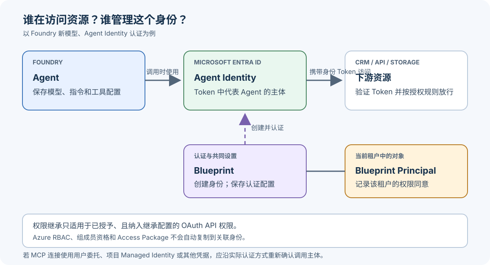

[第一篇](/2026/09/21/foundry_govn/)列出了 Agent 上线前的治理问题，[上一篇](/2026/09/30/foundry_govn_2/)用 Access Package 管理了会议准备 Agent 的 30 天读取权限。本篇只补上一个问题：资源权限最终给了哪个身份？Blueprint 的改动又会影响谁？

**资源权限应授给工具实际使用的身份；修改 Blueprint 前要查清它关联的身份。**下游系统从 Token（访问令牌）识别调用主体。

## 一、先区分“这个 Agent”与“创建它身份的 Blueprint”

会议准备 Agent 是保存模型、指令和工具配置的 Foundry 对象。工具选择 Agent Identity 认证时，**Agent Identity** 是下游资源看到的调用身份；**Agent Identity Blueprint** 负责创建和认证这类身份，并保存可供身份共用的设置。这里的 Blueprint 是 Entra 身份蓝图，不是 Prompt 或工作流模板。[Agent Identity Blueprint](https://learn.microsoft.com/en-us/entra/agent-id/agent-blueprint)

可以先用这条简化关系理解它们：


*示意图：Agent Identity 是下游资源看到的调用主体；Blueprint 提供身份认证配置，并可通过明确的权限继承设置影响关联身份。实际 Foundry 连接也可能使用用户委托、项目 Managed Identity 或其他认证方式。*

Entra 还会显示 **Blueprint Principal**：这是 Blueprint 在当前租户中的对象，记录该租户对 Blueprint 的权限同意。它不是 Agent 访问客户资料时使用的身份。[Blueprint Principal 说明](https://learn.microsoft.com/en-us/entra/agent-id/agent-blueprint#agent-identity-blueprint-principals)

排查时看 ID，不要只认显示名称。Graph 的 `agentIdentityBlueprintId` 对应 Blueprint 的 `appId`；Blueprint Principal 则有自己的 Object ID。两者不是同一个 ID。[Agent Identity 字段定义](https://learn.microsoft.com/en-us/graph/api/resources/agentidentity?view=graph-rest-1.0)

## 二、先确认 Foundry Agent 属于哪种模型

本系列沿用 Foundry 新模型：新建 Agent 时会获得独立的 Blueprint 和 Agent Identity。旧模型则可能让未发布的 Agent 共用项目身份，发布为 Agent Application 后才有独立身份。两种模型目前可能并存；迁移或重建后要重新核对身份 ID 和资源授权。[官方迁移说明](https://learn.microsoft.com/en-us/azure/foundry/agents/how-to/migrate-agent-applications)

Entra 的 Blueprint 本身可以管理多个身份，但不要据此推断同一 Foundry 项目里的新模型 Agent 共用 Blueprint。

## 三、身份独立，为什么还依赖 Blueprint？

Agent Identity 是一种特殊的 Service Principal（Entra 中代表应用或服务的身份对象）。它本身没有凭据，依赖 Blueprint 的认证配置取得 Token。[Agent Identity 的组成](https://learn.microsoft.com/en-us/entra/agent-id/agent-identities)

Foundry 会为 Blueprint 配置联合身份凭据，并由 Agent Service 管理运行时的 Token 交换。工具以 Agent Identity 认证时，目标资源收到的 Token 代表该身份；这条托管流程无需开发者另配客户端密钥或证书。[Foundry 身份与 Token 交换](https://learn.microsoft.com/en-us/azure/foundry/agents/concepts/agent-identity#runtime-token-exchange)

可以把这条链路简化为：

```text
Agent Service → 用 Blueprint 的认证配置取得 Token
              → 代表具体 Agent Identity 调用客户资料工具
              → 目标系统检查该身份的访问权限
```

因此要分开排查认证与授权：Blueprint 认证失败时拿不到 Token；身份认证成功但资源没授予权限时，调用仍会被拒绝。MCP 连接也可能使用项目 Managed Identity（项目托管身份）、沿用当前用户权限的 Entra 委托，或让用户单独登录的 OAuth 透传。排查前先查看连接实际采用哪一种方式。[MCP 工具认证方式](https://learn.microsoft.com/en-us/azure/foundry/agents/how-to/mcp-authentication#supported-authentication-methods)

## 四、权限既可能单独授予，也可能从 Blueprint 继承

上一篇通过安全组成员资格管理读取权限，这是一条具体身份的授权路径。Blueprint 还可配置 **OAuth API 权限继承**，让关联身份复用符合条件的权限。

这里要分清“声明”和“授权”：

| 设置 | 作用 |
| --- | --- |
| Required resource access | 声明 Agent 需要哪些 API 权限，供管理员审阅；本身不授权 |
| Inheritable permissions | 指定哪些资源的 OAuth 权限可被继承；本身不授权 |
| Blueprint Principal 权限同意 | 实际授予权限；满足继承条件时才进入关联身份的 Token |

**声明需要权限，不等于获得权限。**静态同意要求权限先列入 Required resource access；动态同意可以不预先声明，但必须在请求时明确请求。两种方式都要求资源列在继承配置中，并把权限同意授给 Blueprint Principal，才会把符合条件的权限带入关联身份的 Token。直接授予某个 Agent Identity 的 OAuth 权限只适用于该身份。[权限声明、授予与继承](https://learn.microsoft.com/en-us/entra/agent-id/concept-inheritable-permissions)

继承配置可以分别控制 delegated scopes（代表用户访问 API）和 application roles（Agent 以自身身份访问 API）。`allAllowed` 会把指定资源中符合授权条件的权限纳入继承范围，之后新增并获准的权限也可能被继承。[继承配置说明](https://learn.microsoft.com/en-us/entra/agent-id/configure-inheritable-permissions-blueprints)

Azure RBAC、组成员资格和 Access Package 不会因此自动继承。对本例来说，30 天 Access Package 到期后，若仍能读取客户资料，就要查是否还有直接授权或继承的 OAuth 权限；客户 API 实际接受哪种授权，必须在资源端确认。

继承权限不会显示成 Agent Identity 的独立权限条目，而是在签发 Token 时合并。检查时应看 Token 的 `scp`（委托权限）和 `roles`（应用权限）字段，并验证客户 API 的实际响应。[继承权限的运行时呈现](https://learn.microsoft.com/en-us/entra/agent-id/concept-inheritable-permissions#declaration-grant-and-inheritance)

## 五、修改 Blueprint，先确认影响范围

在 Entra 管理中心进入 **Entra ID > Agents > Agent blueprints**，打开对应 Blueprint Principal，可以查看 **Linked agent identities** 和 **Granted permissions**。前者帮助确认关联身份，后者展示已同意的权限；继承配置还需另行核对。[Blueprint 管理入口](https://learn.microsoft.com/en-us/entra/agent-id/manage-agent-blueprint)

对 Blueprint 定向的 **Conditional Access（条件访问）**策略，会覆盖由它创建的 Agent Identity，包括以后新增的身份。Entra 在签发 Token 时按策略条件决定是否放行；策略不会替代目标资源自己的授权判断。[Agent Conditional Access](https://learn.microsoft.com/en-us/entra/identity/conditional-access/agent-id)

它也不会自动覆盖 Agent 的用户账号。OBO（代表登录用户访问）应检查用户策略；API key 调用不经过 Entra Token 签发，因此不受这类 Conditional Access 策略保护。

Entra 架构通常按 **Trust Boundary（信任边界）**规划 Blueprint：共享运行环境和认证材料、能接受共同风险的 Agent 可以共用；必须隔离凭据或运行环境时再分开。Blueprint 的拆分本身不会隔离网络、运行时或数据存储。[身份架构规划](https://learn.microsoft.com/en-us/entra/agent-id/how-to-plan-agent-identity-architecture#step-3-decide-how-many-agent-identity-blueprints)

## 六、回到会议准备 Agent，留下可核对的关系

上线记录保留四项就能帮助排查：Agent Identity ID、Blueprint Application ID、Blueprint Principal Object ID、工具实际使用的认证方式；再注明授权来自 Access Package、直接 OAuth grant 还是继承权限。

验证时分别测试允许与越界的客户记录、Access Package 到期后的新 Token，以及 Blueprint 策略调整后关联身份的结果。现有 Token 和工具缓存可能影响观察结果，需单独核对。以上是待执行的验证步骤，并非租户实测结论。

本篇的判断可以归结为：先确认调用身份，再检查该身份直接获得和从 Blueprint 继承的权限；修改 Blueprint 时按关联身份和信任边界评估影响。下一篇继续讨论 Toolbox 如何处理高影响工具调用的审批。

**You can outsource your thinking, but you cannot outsource your understanding.**

## 官方参考

- [Agent Identity Blueprint 与 Blueprint Principal](https://learn.microsoft.com/en-us/entra/agent-id/agent-blueprint)
- [Foundry 新旧 Agent 模型与迁移](https://learn.microsoft.com/en-us/azure/foundry/agents/how-to/migrate-agent-applications)
- [Agent Identity 与 Foundry 运行时认证](https://learn.microsoft.com/en-us/azure/foundry/agents/concepts/agent-identity)
- [权限声明、授予与继承](https://learn.microsoft.com/en-us/entra/agent-id/concept-inheritable-permissions)
- [配置 Blueprint 继承权限](https://learn.microsoft.com/en-us/entra/agent-id/configure-inheritable-permissions-blueprints)
- [Agent Conditional Access](https://learn.microsoft.com/en-us/entra/identity/conditional-access/agent-id)
- [规划 Agent 身份架构](https://learn.microsoft.com/en-us/entra/agent-id/how-to-plan-agent-identity-architecture)
